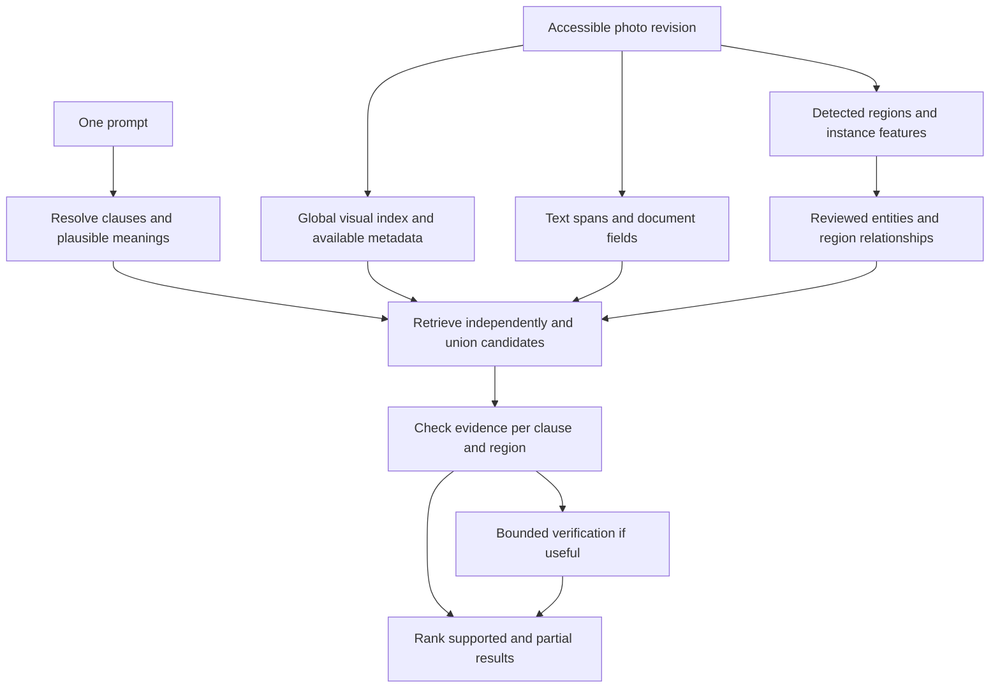

# On-device photo search — architecture and delivery plan

**Decision.** Keep the fast global visual index. Add independently searchable text, named regions and contextual evidence. Retrieve candidates through several paths, then check whether the required details belong together in each candidate. Spend additional phone compute where it can recover a missing result or change an important ranking decision. Start with replayable retrieval and diagnostics before changing a single model weight.

This is a proposed design based solely on the supplied [model brief](astra-on-device-photo-search-model-brief.md). Reported measurements below come from that document. Budgets, depths, decision thresholds and workloads introduced here are engineering proposals. Freeze them before final evaluation. Actual phone quality and speed require implementation and measurement.

## 1. What working means

A user grants access to a library and types one prompt. The app makes the first processed photos searchable, continues indexing in the background, and puts photos satisfying the whole request above photos satisfying only part of it. It can learn a private name once and propose further sightings across photos. The user confirms which sightings count as Named matches. On a repeat search the app reads its encrypted evidence and generally performs only text encoding and ranking.

Three outcomes matter. If there is enough supporting evidence, return the matching photos. If a requested detail is uncertain, return useful candidates with the unresolved condition identified. If a target has no credible candidate, say whether the relevant indexing pass still has work pending or a completed search found no supported match. Even complete indexing cannot recover illegible text, an invisible distinguishing mark, or an unknown ownership relationship. Correct behavior in those cases includes withholding a confident claim.

## 2. Diagnosis and alternatives

| Priority | Observation from the brief | Engineering decision and test that could change it |
| --- | --- | --- |
| 1. Recover enough evidence | ML Kit missed 217 of 360 remembered-text targets. At least one needed token was absent in 213 misses. Tiny gained 44 and lost 27. | Diagnose extraction before relaxing lookup. The union of the engines' observed hits is 187/360. This is an oracle ceiling for selecting their existing successful outputs on this fixture, with no allowance for new false matches. A live cascade must beat a single-engine baseline at acceptable cost. |
| 2. Bind details to the correct entity | Exact-object results were 44/48 first-place hits in a track-based cohort. On independently captured, same-model objects the best pilot reached 8/18 with two references. Garment evidence covered 17/56 people, and a higher-coverage policy also raised false alerts. | Detect and compare the specific region. Keep user confirmation and evidence about attributes independent. Test on hard negatives and absent targets before changing thresholds. |
| 3. Measure the mixed-query bottleneck | The 10k visual index found a known positive in the first five for 24/24 category prompts. Only 17/24 ranked one first. Some results were unjudged. The brief gives no comparable 10k mixed-prompt measurement. | Measure candidate recall and final relevance separately on compound prompts. If candidates are present, improve ranking. If missing, give another evidence source its own retrieval path. |
| 4. Make evidence available sooner | In a warm 300-photo comparison visual-first achieved complete visual coverage at 27.97 s. A cold coordinator took 128.21 s to commit all visual results and 909.74 s for all OCR. | Preserve the visual-first baseline. Trial a small text-work allowance and measure coverage by modality plus foreground latency on ARM. |
| 5. Defer expensive replacements | Host-encoded 10k vectors ranked in 19.47 ms median on the emulator. A second encoder helped top-one results on a 20-prompt host pilot. The trial VLM took about 24 seconds for one warm request. | Retain exact scanning and CLIP initially. Measure end-to-end latency before building an approximate index or adopting a new interactive model. |

| Architecture | What runs | When to choose it |
| --- | --- | --- |
| A. Reuse and rerank | Existing global embedding, OCR, confirmed subjects and metadata. Add candidate union, clause coverage, abstention, and a replay harness. | Build first. Ship this alone for slices where extra features yield negligible improvement. Lowest incremental storage and migration cost. |
| B. Sparse region evidence with selective verification | A plus persistent region coordinates, typed links, selected region vectors, field-aware OCR and bounded additional inference. | Recommended destination. Test each feature against A on its target failure family. Extra features must earn their storage and phone time. |
| C. Rich visual retrieval and learned verification | Compare a stronger global encoder, multiple visual tokens or a compact verifier on B's residual misses. Trial a VLM on top candidates and as an idle-time annotator separately. | Promote only if it improves blind relevance after matching candidate depth, fits both ARM tiers, and preserves offline resource targets. The reported SigLIP 2 artifacts alone use about 378 MB. Keep their experiment separate from the base install. |

## 3. Index design and responsibilities



| Record | Fields the implementation needs | Responsibility |
| --- | --- | --- |
| Photo revision | Stable library key, source revision, orientation, availability, date and place values with source and precision | Bind all derived data to the pixels and metadata that produced it. Distinguish a metadata-only edit from a changed image when the provider permits it. |
| Stage result | Photo revision, extractor/preprocessor version, status, timestamp, retry reason | Distinguish pending, completed with evidence, completed without usable evidence, unsupported, and failed. A completed detector with no box still has a miss rate. |
| Observation | Type, region in source-oriented coordinates, value, model/observation quality, provenance, optional feature-vector key | Store a text span, garment color, face, object crop, document field, or relation. Tie a field to its label/span and an attribute to its subject. Store dimensions, normalization and model version with vectors. |
| Personal entity | Local ID, kind, aliases with validity periods, confirmed region links, rejected links, provenance | Keep personal truth separately editable. The same photo can contain several entities. Changes to a name require updating alias lookup only. |
| Retrieval entry | Photo/region key, compatible feature-space ID, postings or vector, source revision | Provide independent entry points for visual similarity, words/fields, personal references, time and place. Store derived artifacts in the encrypted index. |
| Query result | Photo revision, interpretation, tier, matched clauses, unresolved clauses, conflicts, stage coverage | Expose the evidence necessary to explain a result or reproduce an error locally. Avoid storing a permanent history of user prompts by default. |

Each extractor consumes an image or region with a declared resolution and returns versioned observations. Extractors never decide whether a search result is confirmed. Each retriever accepts relevant query clauses and a depth budget. The ranker consumes evidence records and can run unchanged against recorded outputs. This makes engine swaps and deterministic replay practical.

**Index schedule.** Publish the existing visual batches immediately. In the candidate policy, service a short OCR slice after a visual time slice when text demand is high, then resume visual coverage. Compare strict visual-first, an initial 4:1 visual-to-text time budget, and bounded overlap. Use wall-clock quotas and yield between images since OCR costs vary. Prioritize likely documents and new visible media, age the backlog, and eventually visit low-priority photos. The tested thumbnail skip rule saved only 6.65 s over 300 images and lost one query. Keep omission as a separately evaluated change.

Start with one active inference lane, reusable model sessions and one prefetched decode. Give foreground search priority at image boundaries. Reuse a suitably sized decode across compatible tasks. Read the source again for small text when only a low-resolution scene bitmap is cached. Pause costly specialists under thermal or memory pressure. An interrupted job commits only completed results against the current source revision and resumes from durable work. Handle deletion or permission loss by immediately removing the source from results and purging inaccessible evidence according to lifecycle policy. For source edits, invalidate dependent regions and revalidate confirmed links before reusing their geometry.

## 4. How a prompt becomes an answer

1. **Interpret.** Preserve quoted strings and identifiers. Resolve known personal aliases, date ranges, place anchors, entity types, attributes, relations and negation. Represent the prompt as clauses with subject, predicate, object, polarity, strength and source span. Keep a whole-prompt visual interpretation alongside at most two structured interpretations initially. Route leftover natural-language text through semantic retrieval. Encode shorter clauses individually when the original exceeds the tower's context. For ambiguity that materially changes the answer, show useful candidates from each plausible reading or ask a single disambiguating question.
2. **Generate.** Initial tuning values are top 100 global, 100 text/field and 100 region/instance candidates per relevant route. Include confirmed-name and exact-field postings independently. Intersect explicit, reliable structured conditions directly in postings. For large postings, page deterministically and rank within them, so a confirmed collection does not disappear behind a global top-100 cap. Compare depths 25/100/300 and reserve slots per route when truncating the verification pool. Never require an OCR hit or global CLIP hit for entry through another route.
3. **Evaluate each clause.** Use supported, contradicted, unresolved or pending. Reliable opposite evidence can contradict an explicit field. An absent detector box, weak similarity score or missing GPS usually leaves a clause unresolved. Apply negation only when the evidence source can test it at the required reliability. Match relationships across region IDs in the same photo. Two individually positive observations do not establish a relationship.
4. **Rank.** Use reciprocal-rank fusion as the replayable ordering baseline within a tier. Sum at most one contribution per correlated evidence family, initially the maximum of its route scores 1/(60 + rank). Choose the best internally consistent interpretation per photo. Sort by full support for required clauses, then supported required-clause coverage, preferred evidence, then fused rank. Within ties prefer stronger localized evidence and stable photo order. Exclude reliable contradictions from exact matches. Require an absolute, held-out support threshold for strong semantic or instance claims. Rank alone cannot supply it.
5. **Publish and refine.** Return a first cached result promptly. Reserve up to five additional related results initially, subject to a calibrated evidence floor. Page through all qualifying matches. Offer plausible identity suggestions only in the appropriate suggestion channel. On explicit Named search, require confirmed links and apply requested attributes separately. Group near-duplicates for broad searches while preserving variants when the prompt asks for a version. Allow a later update only for the same active query and current source revisions.

```text
plans = interpret(prompt, localAliases, localCalendar, supportedLanguages)
for plan in plans:
    pool = unionWithRouteReservations(retrieve(plan))
    for photo in pool:
        evidence = currentObservations(photo)
        judgments = evaluateClausesAndBindings(plan, evidence)
        assignTierAndRank(photo, plan, judgments)
publish(bestConsistentInterpretationPerPhoto(), indexedCoverage)
for candidate in unresolvedCandidatesThatCouldChangeTopResults():
    if estimatedCostFitsDeadline() and sourceRevisionStillMatches():
        persistAndRerank(verifyRequestedRegionOrField(candidate))
    else:
        enqueueBoundedBackgroundWork(candidate)
```

**Compound trace.** Consider a request for a named person wearing a described garment at a recurring event. Resolve the person from confirmed aliases. Retrieve through the person's confirmed appearances, event-like scenes, and plausible dates. One photo has the confirmed face, the garment localized to that person's body, and date and visual event evidence. It can rank first with the event characterized as inferred when appropriate. A second has the same person but the requested garment belongs to someone else. Withhold the full-match claim. A third has the person and garment with missing capture time. It remains eligible through the visual event route. A fourth has a lookalike with excellent scene similarity. It stays outside Named results. If no photo has all required evidence, report which condition could not be established and whether its pass is pending. A date-only coincidence should never establish attendance.

**Rescue misses outside the shortlist.** Verification of top candidates cannot recover a photo excluded by every route. Track shortlist recall before reranking. When it is low, test another retrieval entry point, such as OCR postings over all searchable photos, or region embeddings for sparse foreground details. In a live query with insufficient coverage, queue background work for a bounded slice of *unprocessed* photos selected by metadata, prior evidence and a small diversity sample. Publish later only if new evidence improves the same query. Log evaluations of misses from inside and outside the initial pool separately.

## 5. Specialist decisions and local learning

| Query family | Proposed behavior | Failure to test |
| --- | --- | --- |
| Faces and exact objects | Detect regions first. Use SFace for aligned faces, compare DINOv2 and crop CLIP for objects. Compare one exemplar, a mean and up to four diverse confirmed exemplars per subject. Calibrate best-reference similarity and margin over the strongest competing identity by type and crop quality. | Hold out identities and capture sessions. Measure failed detections, wrong merges, background dependence and open-set false accepts. Treat visually identical instances as unresolved. |
| Discover and name | Create provisional region groups with high-precision mutual neighbors. Require compatibility with a group representative and veto known rejected links before adding a region. Present diverse representative crops for review. Naming a group confirms only the explicitly approved members. | Prevent transitive chains of weak links. Support split, merge, undo and local replay of affected suggestions. Keep automatic groups useful even before they have names. |
| Documents and remembered text | Preserve text, geometry, normalized strings and script when available. Retrieve with exact phrases, token postings and controlled fuzzy matches for natural words. Link labels to nearby values for document class, role, date and edition. For uncertain extraction, try source-resolution region OCR and compare Tiny as alternate first pass or selective fallback. | Blind-test unseen layouts, short IDs, wrong field roles and mixed scripts. Use a script-specific engine only after its device and quality gate. An unreadable exact identifier stays unresolved. |
| Clothing, action, spatial relation, fine appearance | Represent people and objects as separate region nodes. Use segmentation to bind clothing to the right visible person. Test geometry for observable 2D relations. Test selective second views or original-pixel crops for edge details. Keep action, depth, lighting and depiction estimates soft until calibrated. | Swap subjects, reverse relations, alter lighting, and include graphics depicting real things. Verify that confidence falls when the decisive detail disappears. |
| Place, time and events | Keep capture, import and edit times distinct. Represent place as an anchor plus uncertainty and soft distance. For an event, use a versioned local date table for supported regions/years, visual retrieval and any confirmed personal event labels as independent evidence. Use validity periods for personal history. | Unknown calendar coverage, moved locations, shared images with delayed imports, annual recurrence and ambiguous place names. Geographic proximity supports a location estimate. It alone cannot establish an event. |
| Groups, copies and versions | Resolve a people group as a set of member constraints with explicit all/any semantics. Represent document version, media template, individual edited file and visual duplicate as separate concepts. Compare lexical differences, visual similarity and confirmed links as appropriate. | Partial membership, unseen group member, same template with changed text, and identifying the exact edit among near-duplicates. |

**Private improvement.** First update local alias and exemplar records after explicit confirmation or rejection. Retain rejected region–entity pairs so the same mistake does not repeatedly return. Select review candidates that add a distinct viewpoint or disambiguate competing entities. Cap prompts initially at three per review session. No review is required for ordinary search. Do not treat a click or skipped result as an identity label. Allow deletion of an exemplar or all personalization and recompute affected prototypes and suggestions. Keep historical alias periods separately editable.

**Learn the allocation policy before training a foundation model.** Record which deferred verifications recovered an intended photo, time spent, and coverage by modality using permitted evaluation data. Compare a cheap rule (requested clause unresolved and candidate close to an acceptance boundary) with a small learned policy estimating expected recovered hits per second. Include exploratory sampling outside prior successful categories. Without coverage there, training would favor only situations the old system already recognized. For local users with sparse feedback keep frozen encoders and editable exemplars. Fit personal calibration only after a time-separated holdout shows an advantage. Shipping an update should not require exporting private queries or reference photos.


## 6. Resource envelope and failure recovery

**Storage planning scenario.** The measured 10k global database uses 44.77 MiB, about 4,695 bytes per photo. Use that footprint as an empirical starting point. For a first B budget, assume 50% of photos have zero persistent detail vectors, 35% have one and 15% have three, for a mean of 0.8. Budget 640 bytes per retained vector including a proposed quantized payload and row metadata, plus 3,072 bytes per photo on average for OCR postings, geometry, entity links and stage state. These are assumptions to test on text-heavy and crowded libraries. Add 25% headroom on the incremental component for database overhead. This gives about 9,175 bytes per photo across the scenario. Fixed weights, app code, native libraries and temporary files are separate.

| Distinct photos | Global store projected at measured rate | B total steady-state derived data | Temporary budget if a full second B index is required |
| --- | ---: | ---: | ---: |
| 10,000 | 44.8 MiB | 87.5 MiB | Up to another 87.5 MiB before journal/compaction overhead |
| 25,000 | 111.9 MiB | 218.7 MiB | Up to another 218.7 MiB before journal/compaction overhead |
| 50,000 | 223.9 MiB | 437.5 MiB | Up to another 437.5 MiB before journal/compaction overhead |

The current seven explicit weight files add 226.1 MiB, excluding OCR SDK internals. Inspect actual page use, journals, migration peaks and installed size on ARM. Retain region coordinates and confirmed references even when dropping a recomputable detail vector. Use a separate allowance for user-confirmed regions in crowded photos. At the target device's free-space floor, pause optional enrichment or migrate one modality at a time. Test a text-heavy corpus that breaks the average before adopting a storage promise.

**Latency planning scenario.** For a warm query allocate 200 ms for planning and text encoding, 500 ms for retrieval and cache reads, 400 ms for evidence joins and ranking, 400 ms for result delivery and first visible thumbnails, and 1,500 ms slack for contention or bounded verification. These are engineering allocations for a 3 s deadline. Measure total latency directly. Expensive verification can arrive after the first result. A three-second result that always gets reordered into something different is poor retrieval, so measure first-result relevance and time to stable top five too.

**Device policy.** Benchmark CPU as the portable reference and then each available accelerated execution path on each test phone. Check operator fallback, precision drift, initialization, peak memory and sustained heat. Establish a memory high-water mark with real concurrent search and indexing before enabling overlap. Try batches of 1, 8 and 32 for cheap visual work and short cancellable OCR slices. Begin with exact vector scan. Consider an approximate region index only if profiling shows the region scan dominates the retrieval allocation at realistic scale and the saved time survives its recall, update and storage cost.

**Model updates.** Tag a feature space by weights, tokenizer, preprocessing, dimensions and normalization. Tag downstream evidence by the input versions it depends on. Never compare incompatible vector spaces. Backfill a new modality in bounded chunks under its own version. Keep serving a complete old version until cutover, or retrieve separately from compatible cohorts during a controlled trial. Switch the active version transactionally. Roll back via the active-version pointer and regenerate only affected artifacts. Require current source permission and revision on every displayed result.

## 7. Experiments, dependencies and delivery gates

All gates below are proposed defaults. Freeze them and the decision dataset before examining held-out outcomes. Record both absolute values and paired differences. Separate release-blocking correctness properties from workload-dependent statistical goals.

| Order | Depends on | Deliverable and comparison | Exit decision |
| --- | --- | --- | --- |
| 0. Reproducible baseline | Supplied project baseline | Freeze image IDs, licenses, hashes, source-group splits, query labels, model versions, inputs and resource settings. Capture candidate lists, ranks, per-clause evidence and availability. | Reproduce the frozen results or explain mismatches before using them as controls. Keep host, emulator and ARM receipts distinct. |
| 1. Error census | 0 | Start with approximately 200 sampled successes and failures stratified by query family. Label source readability and substitute one oracle at a time: intended parse, correct region/text, forced candidate, correct binding. | Identify the largest recoverable losses with uncertainty. If gold transcripts barely help, prioritize parsing or ranking over another recognizer. |
| 2. Architecture A | 0, 1 | Implement typed evidence, independent retrieval, rank fusion, uncertain/absent states and per-stage coverage. Replay using existing features. Compare candidate depth and query paraphrases. | Smallest useful release. Require zero unconfirmed entries in confirmed-only Named tests, zero stale/deleted rows in results, and earlier valid partial results under interrupted indexing. |
| 3a. Text and documents | 1, 2 | Compare ML Kit, Tiny, a conditional two-engine cascade, and field-aware retrieval. Separate whole-photo cost from text detection and recognition. Repeat the 360 remembered queries and run fresh difficult documents. | Choose by retrieval utility, precision on easily confused fields and sustained ARM cost. Reject an engine swap that regresses important query slices beyond the frozen margin. |
| 3b. Entities and binding | 1, 2 | Add typed regions, competing-reference margins, reviewable grouping and limited relationship checks. Compare one versus several references, manual versus automatic crops, and color ownership on lookalikes. | Require held-out suggestion precision and coverage together. Keep a low-coverage family in explicit review until evidence justifies broader use. |
| 3c. Context and presentation of evidence | 2 | Test event/date mixtures, personal history, geographic uncertainty, depiction versus physical subject, and duplicate/version retrieval. | Improve the intended interpretation across disagreement and missing-data cohorts. Ensure a reliable contradiction prevents a full-support claim. |
| 4. Integrated B on devices | 2, relevant 3 branches | Combine only successful changes. Run phased indexing, interruption, incremental edits, foreground contention, encrypted byte accounting and blind mixed-query evaluation. | Promote per validated query family and device tier. If B fails a budget, fall back to A for that capability while retaining confirmed knowledge. |
| 5. Challenger C | Residual diagnosis from 4 | Run fixed-pool encoder/verifier comparisons, then independent-retrieval comparisons. For a VLM compare cached idle-time enrichment with capped top-candidate checking. Score factual support and incomplete outputs. | Advance only on distinct residual failures that B cannot address within budget. Stage and verify exact artifact, permission to redistribute, reproducible hash, operator support and conversion quality before packaging. |
| 6. Local adaptation and upgrades | 2, 3b, 4 | Replay sequences of real or simulated explicit confirmations, rejections, splits, renames and reversals in temporal order. Exercise model migration, rollback and interrupted writes. | Future-session retrieval improves for corrected entities, undo restores expected results, and no corrections leak into unrelated entities. |

**Benchmark and annotation budget.** Use at least 10,000 distinct permitted real images in a mixed gallery with additional hard cohorts. Start development with about 600 independent intents across scenes, identity, OCR/documents, relations, context and absent targets, plus paraphrases assigned to the same split as their originals. Pool and blind top results from alternatives, add deliberately missed positives, and mark unjudged items explicitly. Double-label ambiguous queries and disagreements. As an initial labor estimate, 600 intents × 15 candidate judgments × 20 seconds is 50 reviewer-hours for one pass before writing queries, resolving disagreements or annotating regions. Start smaller for the first error census. Reserve independent labeled test intents and enough absent-target trials for the requested confidence level. Split by subject, capture session, near-duplicate group and template before tuning.

**Data for training.** Architecture A and exemplar-based personalization require no new encoder training. For a small router, allocation policy or ranking head, compare learning curves at 100, 300 and 1,000 labeled intents or decisions, grouped by original intent and source session. For a specialist verifier, first estimate an oracle ceiling, then trial 1,000 to 10,000 licensed region/relationship pairs with difficult negatives, holding entire entities and scenes out. These are experiment budgets, not sufficiency estimates. Stop when the improvement is smaller than the paired uncertainty or the smallest worthwhile deployment gain. Model cost includes annotation, validation, conversions and rebuild time.

**Physical protocol.** Select a lower-memory midrange ARM phone and a faster ARM phone. Record chipset, RAM, OS, runtime/provider, thread counts and available storage. Use the same manifest, orientation handling, display settings, starting battery band and ambient conditions. Measure cold and warm separately, use at least three repeated runs with alternating variant order, and run a sustained indexing interval of at least 30 minutes per condition. Exercise idle search, active indexing and low-power operation. Record cold start, time to first useful result, modality coverage at 10/50/95%, time to stable ranking, peak process memory, encrypted bytes and thermal/energy counters available on each device. Report unavailable counters explicitly. Use the emulator for deterministic regressions.

**Default promotion criteria**

- **Relevance.** Proposed material improvement for B over A is at least +0.05 absolute mixed-query nDCG@5 with a paired 95% interval above zero. Report top-one, top-five, candidate recall at each tested depth and success on all required clauses. Investigate any priority family falling by more than 2 percentage points. Keep the final test locked. Bootstrap by independent intent or entity, not by paraphrase or duplicate photo.
- **Identity and abstention.** Suggested first target is at least 95% precision on emitted identity proposals at a useful, predeclared minimum coverage of 30% of matchable queries. Explicit Named provenance must hold in every regression case. For absent-target testing, target an upper one-sided 95% confidence limit below 1% for false strong identity claims. Even zero errors takes about 300 independent absent-target trials to support that bound. Measure separately for faces and objects. If evidence is insufficient, retain review-only handling and publish the uncertainty.
- **Time and space.** Require warm end-to-end p95 at or below 3 s on each supported ARM tier at 10k photos, during both idle search and active indexing. Reopening and ordinary repeated searches must reuse current index evidence. Investigate first-visual-coverage regressions over 10% versus the paired device baseline. Use 100 MiB at 10k and 500 MiB at 50k as provisional steady-state derived-index ceilings, with measured storage for heavy-text libraries and migration space reported separately.
- **Safety of release decisions.** Publish results and misses for both the chosen model and its control, including incremental gains/losses and costs. An improvement averaged across easy queries cannot clear a failed identity, stale-evidence or exact-field correctness gate. Roll back the specific model or policy if a verified invariant fails or measured device budgets are repeatedly exceeded.

## 8. First implementation decision

Build steps 0–2 as one vertical slice. Deliver it when the same prompt can be replayed against a frozen index, a reviewer can identify where the intended photo was lost, an interrupted OCR pass produces an honest partial result, and an unconfirmed identity cannot appear as confirmed. Then choose the first new model experiment from measured recoverable losses. The supplied figures favor OCR extraction and exact-instance discrimination as the first parallel investigations. The first mixed-query benchmark decides which deserves the next unit of phone compute.

